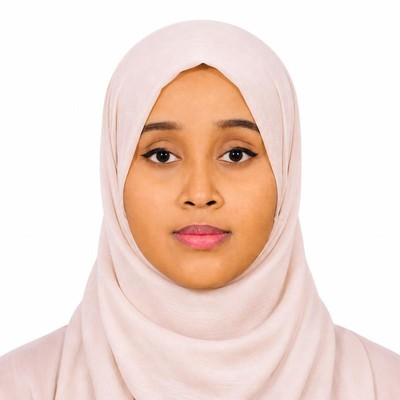

# Habsa Omar Ibrahim

**Computer Engineer · AI & Machine Learning · University Lecturer**

📍 Djibouti &nbsp;·&nbsp; 🎓 M.Sc. Computer Engineering, Istanbul Aydın University

---

## 🌿 About Me

I am a computer engineer with a Master's degree in Computer Engineering, focused on **Artificial Intelligence**, **Machine Learning**, and **Natural Language Processing**. I build intelligent, practical solutions in **Python**, from NLP classifiers to AI-powered chatbots, with a strong interest in software engineering and digital product development.

I also teach **Software Engineering** to third-year Computer Engineering students at the **University of Djibouti**, where I enjoy turning technical concepts into clear, structured learning.

- 🔭 Building AI solutions with NLP, chatbots, and machine learning
- 📚 Teaching Software Engineering at the University of Djibouti
- 🌱 Following new developments in AI and data science

---

## 🧰 Technical Skills

| Area | Skills |
| :--- | :--- |
| **Programming** | Python |
| **Artificial Intelligence** | Machine Learning, Natural Language Processing (NLP), AI chatbots |
| **Machine Learning Algorithms** | Support Vector Machines (SVM), Logistic Regression |
| **Computer Vision** | OpenCV |
| **Software & IT** | Software development, IT project management, software installation and configuration, IT support and maintenance, server environments, computer hardware |

---

## ✨ Featured Projects

### 🎨 Atelier Digital
A website for a digital studio in Djibouti that helps new ideas and existing businesses build their online presence: websites, online platforms, mobile applications, and digital invitations. It includes a language switcher, two customer paths (starting from scratch or digitizing an existing business), service cards, an interactive project builder that generates a ready-to-send WhatsApp message, a five-step work process, and FAQs.
`Web Development` · `UX Design`

### 🤖 CLE Assistant
An AI-based chatbot designed and developed during my internship at the Centre de Leadership et de l'Entrepreneuriat (CLE) to help entrepreneurs in Djibouti. It provides information on business creation, taxation, legal matters, financing, and the Startup Act.
`AI` · `Chatbot`

### 🛡️ Hate Speech Detection Using NLP Techniques
An academic project comparing several machine learning algorithms for detecting hate speech in text, with SVM and Logistic Regression achieving **94% precision**.
`NLP` · `Machine Learning` · `Python`

### 💬 Sentiment-Aware Mental Health Chatbot for Emotional Support
My Master's project: an emotion-aware chatbot designed to provide personalized emotional support.
`NLP` · `Sentiment Analysis` · `Chatbot`

### 🌍 Intelligent Vision for Environmental Protection
A supervised project: an intelligent vision application built in Python with OpenCV to support environmental protection efforts.
`Computer Vision` · `Python` · `OpenCV`

---

## 🎓 Teaching & Research

### Teaching
**Part-time Lecturer, Faculty of Engineering** · University of Djibouti
*September 2026 – Present*
Teaching the **Software Engineering** module to third-year undergraduate students in Computer Engineering.

### Research
**ICCCNet 2024** · Manchester, United Kingdom · *October 2024*
Presented the paper **"Predicting Car Prices Using Machine Learning Algorithms"**, sharing insights on machine learning techniques applied to the automotive market.
📄 [Read the paper on Springer](https://link.springer.com/chapter/10.1007/978-981-96-3244-2_35)

---

## 💼 Professional Experience

**IT Intern** · Centre de Leadership et de l'Entrepreneuriat (CLE), Djibouti
*March 2026 – April 2026*
- Contributed to an intelligent digital solution supporting entrepreneurs in Djibouti
- Designed and developed **CLE Assistant**, an AI-based chatbot

**IT Intern** · Air Djibouti, Djibouti
*December 2025 – February 2026*
- Assisted with IT maintenance and support operations
- Installed, configured, and updated software and IT equipment
- Worked with server environments and computer hardware components

---

## 📖 Education

| Degree | Institution | Years |
| :--- | :--- | :--- |
| **Master's (M2), Computer Engineering** | Istanbul Aydın University | 2024 – 2025 |
| **Master's (M1), Computer Hardware Engineering** | Istanbul Aydın University | 2023 – 2024 |
| **English Preparatory Program** | Istanbul Aydın University | 2022 – 2023 |
| **Bachelor's (Licence), Computer Science** | University of Djibouti | 2018 – 2021 |

---

## 🌐 Languages

English · French · Arabic · Turkish · Somali

---

## 📫 Let's Connect

- ✉️ **Email:** [ohabsa2@gmail.com](mailto:ohabsa2@gmail.com)
- 💼 **LinkedIn:** [Habsa Omar Ibrahim](https://www.linkedin.com/in/habsa-omar-ibrahim-23830b33a/)
- 🐙 **GitHub:** [github.com/habsa-dev-techL](https://github.com/habsa-dev-techL)
- 🌍 **Portfolio:** coming soon

---
